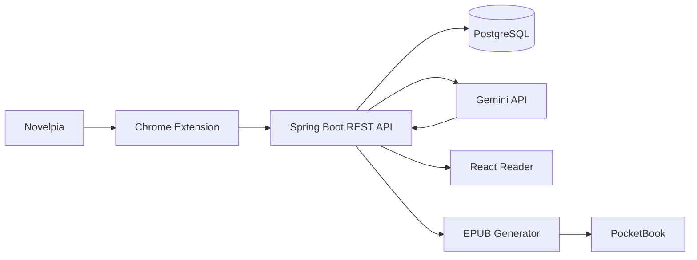

# Aura Translator

Aura Translator is a personal web-novel translation and reading application built around a simple workflow:

> import a chapter from the browser → translate it with an LLM → store both source and translation → read it in Aura → optionally export the novel to an e-reader.

The current `v0.1` prototype focuses on Korean-to-English web-novel translation and demonstrates an end-to-end system spanning a Chrome extension, Spring Boot backend, PostgreSQL persistence, Gemini integration, a React reader, and EPUB export for a PocketBook device.

## Demo

A short demo shows the complete flow:

1. Open a novel chapter in the browser.
2. Import it through the Aura Chrome extension.
3. Translate and persist the chapter.
4. Read the translation in the Aura web interface.
5. Switch between the translation and original text.
6. Export the translated novel as an EPUB to a connected PocketBook.

> **Demo video:** [Watch the end-to-end demonstration](https://youtu.be/QLzIz7I3g-s)

## Features

- Chrome extension for importing rendered Novelpia chapters
- Automatic novel and chapter detection
- Korean-to-English translation through Gemini
- Persistent storage of original chapters and translations
- Translated novel titles
- Novel cover extraction from source metadata
- React-based novel library and chapter reader
- Original / translated text toggle
- Adjustable reader font family and font size
- Reader preferences persisted with `localStorage`
- Chapter navigation
- Retranslation of previously imported chapters
- Flyway-managed PostgreSQL schema
- Experimental EPUB generation
- Experimental direct export to a mounted PocketBook
- EPUB cover embedding and stable book identifiers

## Architecture



### Import flow

```text
Novelpia chapter
    ↓
Chrome extension reads rendered DOM
    ↓
POST /api/import/chapter/translate
    ↓
Spring Boot finds or creates Novel + Chapter
    ↓
Gemini translates the chapter
    ↓
Original + translation persisted in PostgreSQL
    ↓
React reader displays the result
```

The extension is responsible for source-site-specific extraction. The backend works with normalized application data rather than trying to understand the browser DOM itself.

## Technology Stack

### Backend

- Java 21
- Spring Boot 3.5
- Spring Web
- Spring Data JPA
- Hibernate
- Bean Validation
- PostgreSQL
- Flyway
- Maven
- Testcontainers
- JUnit 5
- Mockito
- Springdoc OpenAPI
- Google Gemini API

### Frontend

- React 19
- TypeScript
- Vite
- CSS
- Browser `localStorage` for reader preferences

### Browser Integration

- Chrome Extension Manifest V3
- Plain JavaScript content script and popup
- DOM extraction from the authenticated browser session

## Domain Model

The main persisted entities are:

```text
Novel
 └── Chapter
      └── ChapterTranslation
```

A novel stores source metadata such as:

- original title
- translated title
- source language
- source URL
- cover URL

Each chapter stores the original source text.

Translations are stored separately so a chapter can support multiple target languages without replacing its original content.

## Reader

The reader is intentionally translation-first.

When a translation exists, Aura displays the translated text by default. The original source text can be shown with **View Original**.

Reader settings currently include:

- serif / sans-serif font
- adjustable font size
- persisted preferences between reloads

The interface uses a warm, minimal reading-oriented design rather than a dashboard-heavy layout.

## Chrome Extension

The Chrome extension imports chapter data from a Novelpia viewer page.

It currently extracts:

- novel title
- canonical novel URL
- novel cover URL
- chapter number
- rendered chapter text
- source language
- target language

Example request:

```json
{
  "novelTitle": "Example Novel",
  "sourceUrl": "https://novelpia.com/novel/123456",
  "sourceLanguage": "ko",
  "chapterNumber": 42,
  "rawText": "Original Korean chapter text...",
  "coverUrl": "https://novelpia.com/imagebox/cover/example.file",
  "targetLanguage": "en"
}
```

The extension sends the extracted content to the local Aura backend for persistence and translation.

## Translation

Aura uses a small provider abstraction so translation logic is not coupled directly to one model implementation.

The current provider uses Google Gemini.

Conceptually:

```java
TranslationProvider.translate(
    text,
    sourceLanguage,
    targetLanguage
);
```

This leaves room for additional providers later without changing the core translation service.

## REST API

Main endpoints in `v0.1` include:

```text
POST   /api/novels
GET    /api/novels
GET    /api/novels/{novelId}
DELETE /api/novels/{novelId}

POST   /api/novels/{novelId}/chapters
GET    /api/novels/{novelId}/chapters
GET    /api/novels/{novelId}/chapters/{chapterNumber}
DELETE /api/novels/{novelId}/chapters/{chapterNumber}

POST   /api/novels/{novelId}/chapters/{chapterNumber}/translations
GET    /api/novels/{novelId}/chapters/{chapterNumber}/translations/{targetLanguage}

POST   /api/import/chapter/translate
```

An experimental local endpoint is also used for PocketBook export:

```text
POST /api/novels/{novelId}/export/pocketbook
```

## EPUB / PocketBook Export

Aura can rebuild a complete EPUB from all currently translated chapters of a novel.

The exporter:

- loads chapters in chapter-number order
- requires an English translation for every exported chapter
- embeds the stored novel cover when available
- generates a table of contents
- writes every chapter as XHTML
- uses a stable EPUB identifier
- writes to a temporary file first
- replaces the previous EPUB only after the new file has been written

The stable identifier follows:

```text
urn:aura:novel:{novelId}
```

The generated filename follows:

```text
aura-{novelId}.epub
```

This export path is intentionally experimental and currently assumes a locally mounted e-reader.

## Repository Scope

This repository is a **public project showcase** for Aura Translator.

The working implementation is maintained privately. Source code, API credentials, database configuration, and local device-specific setup are therefore not distributed through this repository.

The purpose of this repository is to document the architecture, implementation decisions, technology stack, and working end-to-end behavior of the project.

The demo above shows the complete flow from browser import through translation, persistence, reading, and PocketBook export.

## Runtime Architecture

The private implementation runs locally with:

- a Spring Boot backend
- a React/Vite frontend
- PostgreSQL
- a Chrome extension for source extraction
- Google Gemini API integration
- an optional mounted PocketBook device for direct EPUB export

The PocketBook integration is intentionally local and machine-specific.

## Testing

The private implementation includes automated backend tests using JUnit 5, Mockito, Spring Boot testing support, and Testcontainers.

Service-level tests cover behavior such as:

- creating a novel during first import
- translating and storing a novel title
- preserving an existing translated title
- updating metadata for existing novels
- importing and updating chapters
- persisting chapter translations
- repository interactions and service behavior

## Current Limitations

Aura `v0.1` is intentionally a focused prototype.

Current limitations include:

- Korean-to-English is the primary tested translation path.
- The Chrome extension is source-site-specific.
- Inline chapter images are not preserved; chapter extraction currently stores text content.
- Translation calls are synchronous.
- Provider selection is not exposed in the UI.
- There is no authentication or multi-user model.
- PocketBook export is local and machine-specific.
- EPUB generation is intentionally lightweight rather than a complete publishing system.
- Source-site availability and markup changes can affect browser extraction.

## Planned Directions

Possible future work includes:

- glossary support
- per-novel translation memory
- translation refinement workflows
- multiple translation providers
- BYOK provider configuration
- improved Korean-specific translation prompting
- background translation jobs
- richer EPUB support
- containerized deployment
- additional source integrations

These are intentionally outside the scope of `v0.1`.

## Project Goals

Aura is primarily an exercise in building a complete application around a real workflow rather than an isolated API or CRUD example.

The project combines:

- browser integration
- REST API design
- relational persistence
- LLM integration
- frontend state and UX
- automated testing
- database migrations
- file generation
- physical-device export

The focus of `v0.1` is demonstrating that the complete pipeline works end to end.

## Legal / Usage Note

Aura is intended as a personal translation and reading tool. Users are responsible for respecting the terms of service, access rules, and copyright restrictions of any source from which they import content.

## Source Availability

Aura Translator is currently a private project. This public repository contains the project documentation and demo rather than the implementation source.

## Status

`v0.1` — working prototype.

Core flow implemented:

```text
Import → Translate → Persist → Read → Export
```

